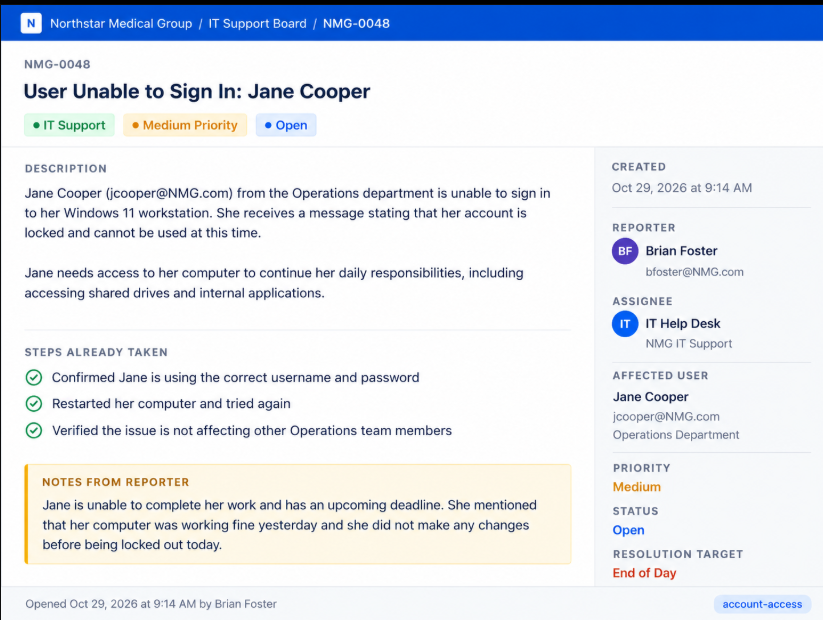
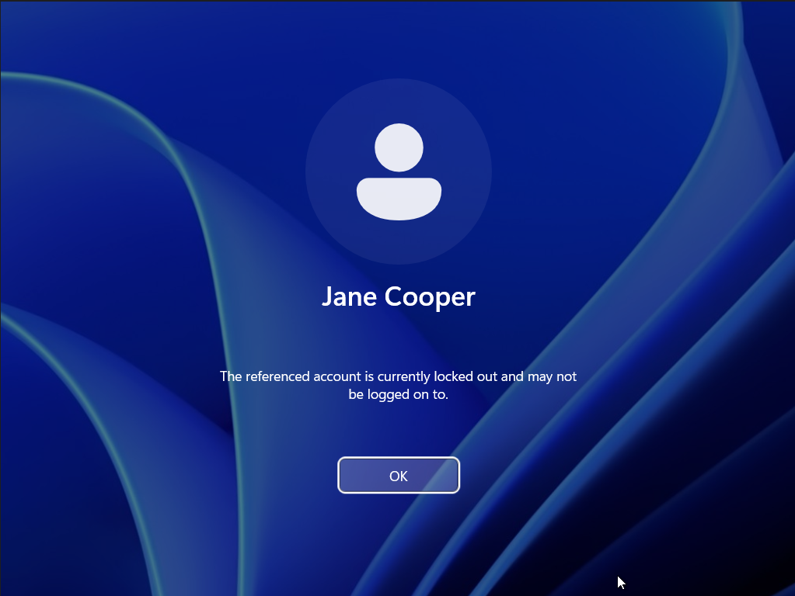
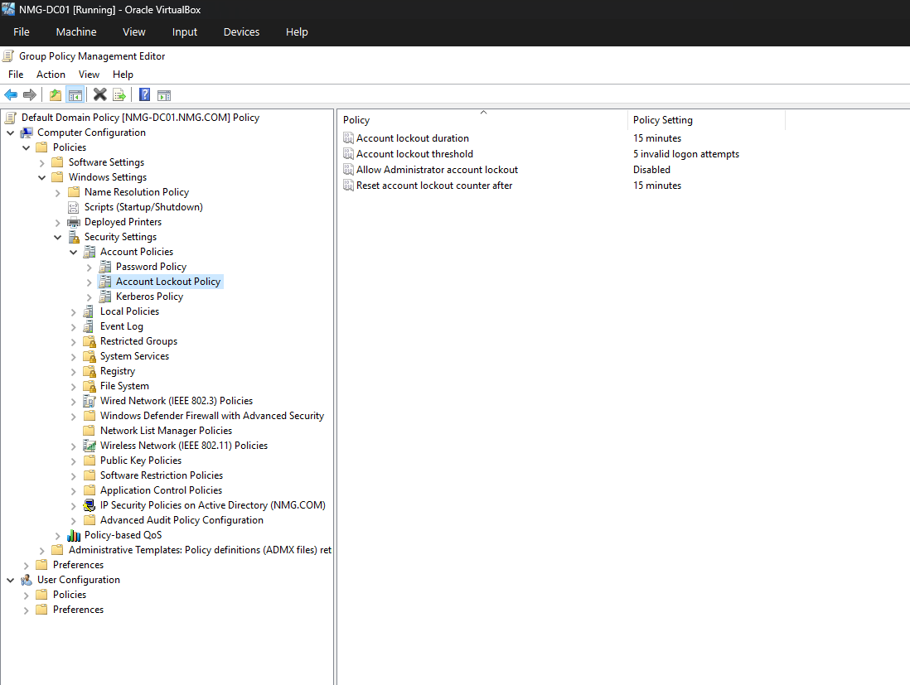
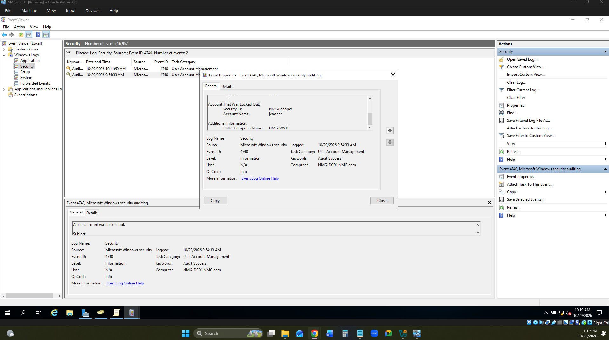
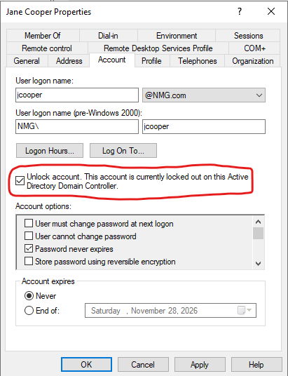
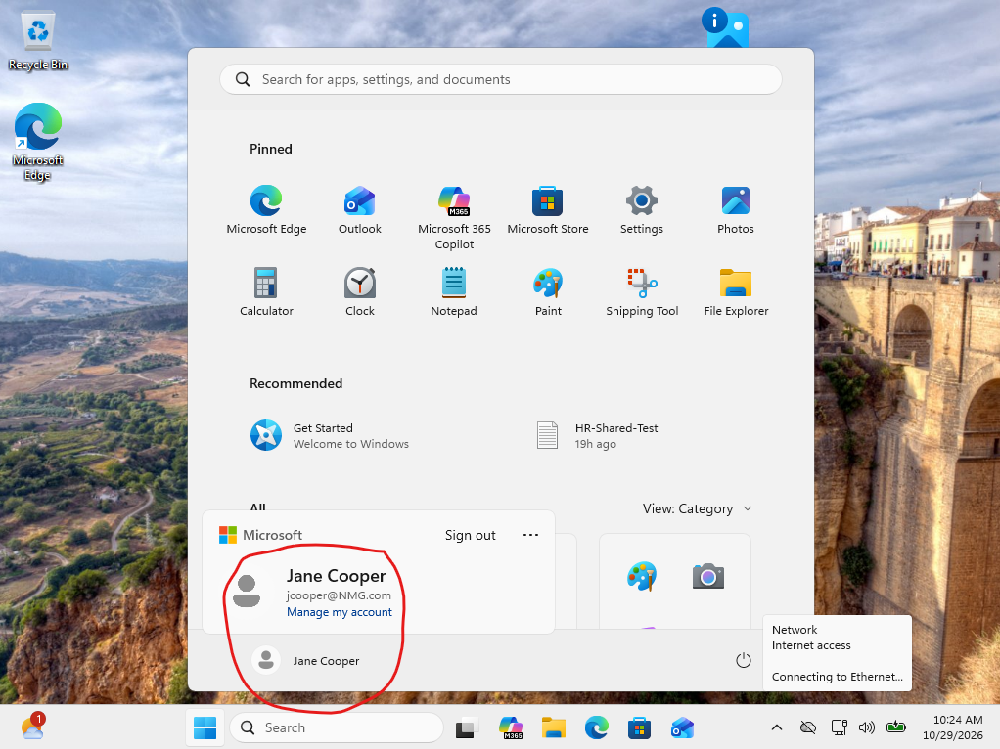

# Day 6 — Incident Report: NMG-0048

## Incident Summary

**Ticket:** NMG-0048  
**Issue:** Active Directory Account Lockout  
**Affected User:** Jane Cooper (`jcooper`)  
**Department:** HR  
**Workstation:** NMG-WS01  
**Domain Controller:** NMG-DC01  
**Status:** Resolved  

## 1. Incident Description

Jane Cooper was unable to sign in to her Windows 11 workstation due to an Active Directory account lockout.

The objective was to reproduce the issue, investigate the authentication failure, identify its source, restore account access, and verify successful domain authentication.

## 2. Issue Reproduction

Simulated repeated incorrect password attempts for Jane Cooper on NMG-WS01.

The workstation displayed authentication errors, and the domain account was eventually locked.

## 3. Group Policy Configuration

Configured the domain's account lockout policy through Group Policy Management.

**Configured settings:**
- Account lockout threshold: 5 invalid attempts
- Account lockout duration: 15 minutes
- Reset account lockout counter after: 15 minutes
- Allow Administrator account lockout: Disabled

## 4. Investigation

Used Event Viewer on NMG-DC01 to investigate the account lockout.

**Findings:**
- Event ID: 4740
- Event Description: A user account was locked out
- Affected Account: `jcooper`
- Caller Computer: NMG-WS01

The security event identified NMG-WS01 as the workstation associated with the account lockout.

## 5. Root Cause

Repeated incorrect password attempts triggered the Active Directory account lockout policy.

The issue was intentionally reproduced in an isolated lab environment to simulate a realistic IT Help Desk incident.

## 6. Corrective Action

Restored Jane Cooper's account access through Active Directory and confirmed the account was no longer locked.

## 7. Resolution Verification

Successfully signed in to NMG-WS01 using Jane Cooper's domain credentials.

Verified the authenticated user by running:

    whoami

**Verified account:** `nmg\jcooper`

**Final Status:** Resolved

## 8. Skills Demonstrated

- Active Directory user account administration
- Group Policy Management and configuration
- Windows Event Viewer troubleshooting
- Security Event ID 4740 analysis
- Windows 11 authentication troubleshooting
- Account lockout investigation and resolution
- Incident reporting and technical documentation
