# Windows Infrastructure & Access Control (AD)(GPO)(RBAC)

## Project Overview

Expanded Northstar Medical Group's (NMG) simulated Active Directory environment to practice Windows workstation integration, Group Policy management, network file sharing, and access control.

This project demonstrates hands-on experience with Windows Server 2019, Windows 11, Active Directory, Group Policy Objects (GPOs), and NTFS permissions.

## Problem Statement

NMG's fictional IT environment lacked standardized workstation security policies and centralized departmental file sharing. Without automated drive mapping and properly configured access permissions, employees could experience inconsistent access to company resources and potential exposure of sensitive departmental information.

## Solution Overview

I deployed a Windows 11 workstation (NMG-WS01) and joined it to the NMG.com Active Directory domain.

After configuring internal networking and DNS connectivity, I created a Workstations OU and implemented a Group Policy Object (GPO) enforcing a 15-minute inactivity limit.

I then configured 4 departmental SMB network shares (Finance, HR, IT, and Operations), applying NTFS and share permissions through existing Active Directory security groups.

Using Group Policy Preferences, I automated departmental drive mapping based on security group membership.

Finally, I tested employee access across all 4 departments, verified unauthorized access was denied, and confirmed file creation, modification, and deletion permissions.

## Video Walkthrough

Coming Soon

## Tools Used

* Windows Server 2019 - Domain Controller and File Sharing
* Windows 11 Pro - Domain-Joined Employee Workstation
* Active Directory Domain Services (AD DS) - Domain and Security Group Management
* Group Policy Management - Workstation Security and Drive Mapping
* SMB and NTFS - Network File Sharing and File Permissions
* DNS - Domain Controller Discovery and Name Resolution
* Oracle VirtualBox - Virtualized Lab Environment
* GitHub - Project Documentation and Evidence

## Project Timeline & Evidence

### Day 5 — Windows 11 Deployment and Domain Integration

Deployed Windows 11 Pro as NMG-WS01 and joined the workstation to the NMG.com Active Directory domain.

**Windows 11 Workstation**

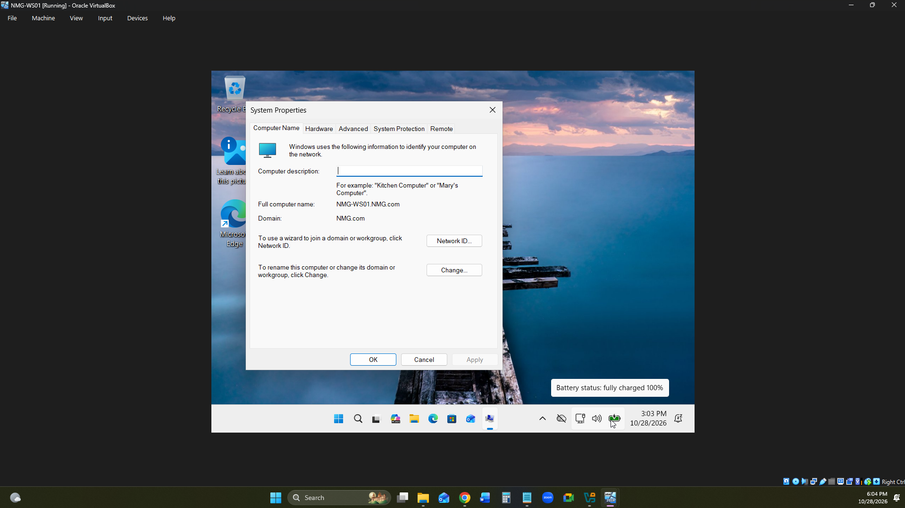

**Workstations Organizational Unit**

Created a dedicated OU to organize domain-joined workstations.

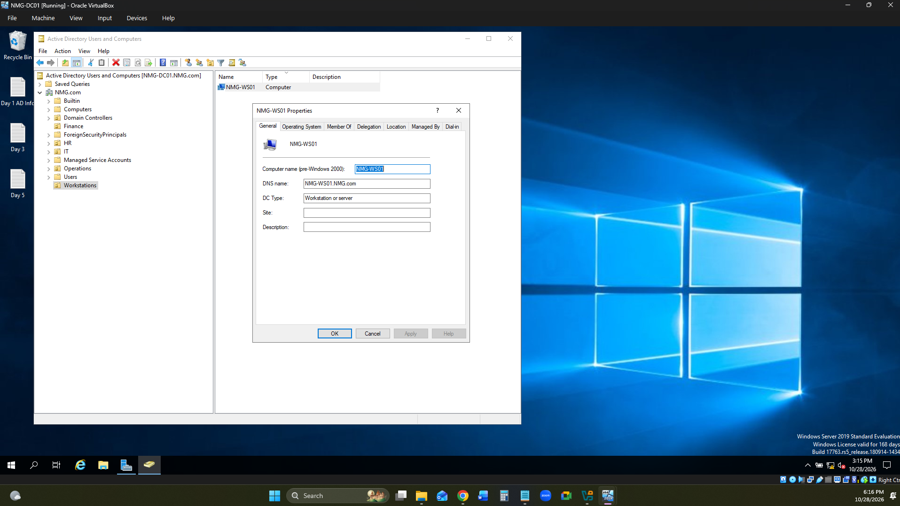

### Day 5 — Network Configuration and DNS Verification

Configured the workstation's network settings to communicate with NMG-DC01.

Verified IP configuration, domain controller connectivity, and DNS name resolution.

**IP Configuration**

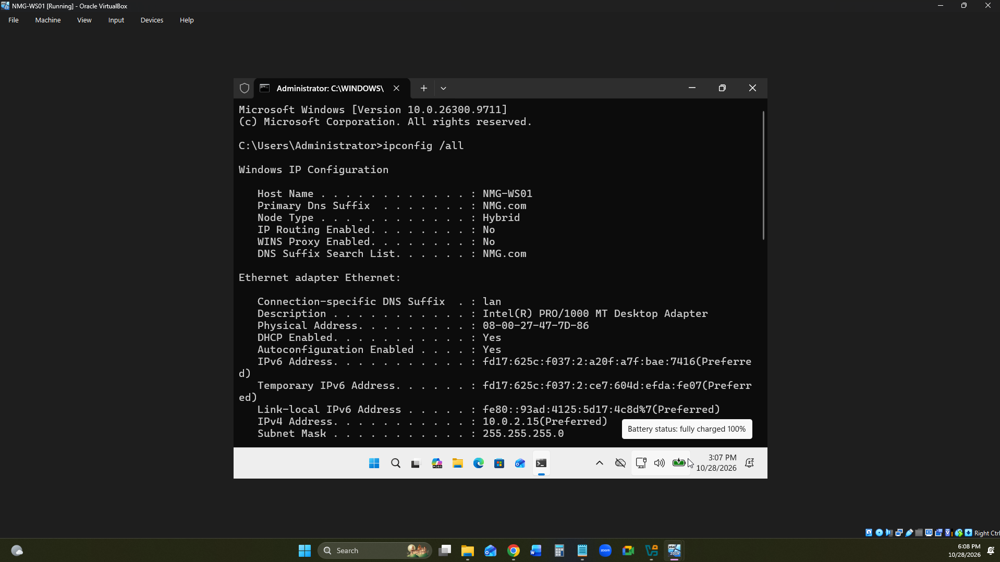

**Network Connectivity Test**

Used `ping` to verify connectivity between NMG-WS01 and the domain controller.

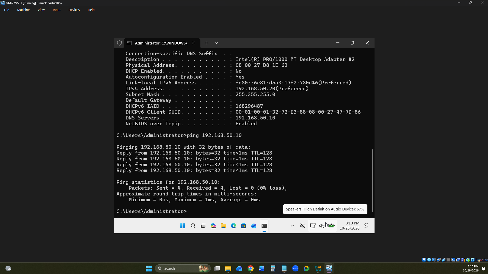

**DNS Name Resolution**

Used `nslookup` to verify domain name resolution.

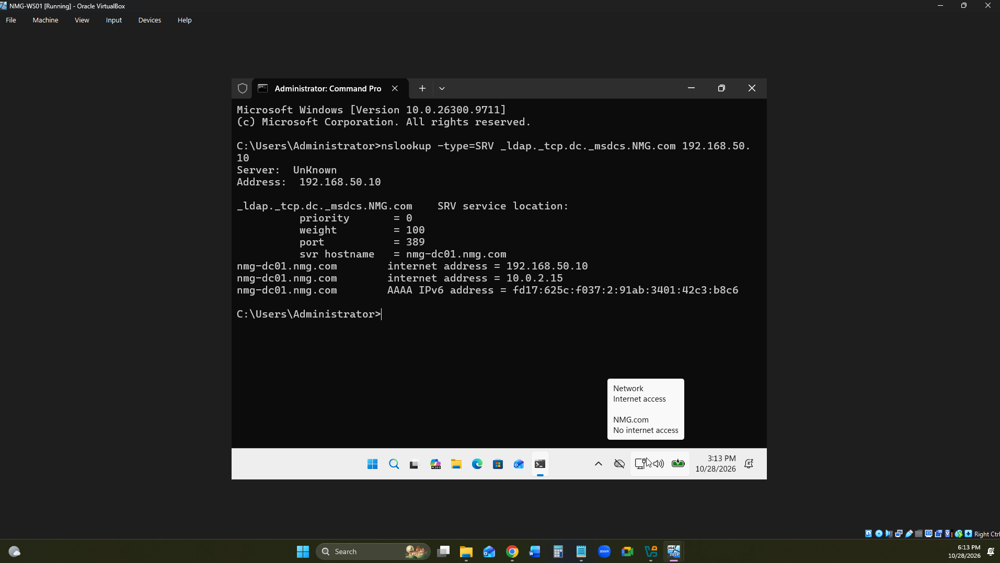

### Day 5 — Group Policy Security Baseline

Created and applied workstation security policies through Group Policy Management.

Configured a 15-minute inactivity limit to automatically lock unattended workstations.

**Workstation Security GPO**

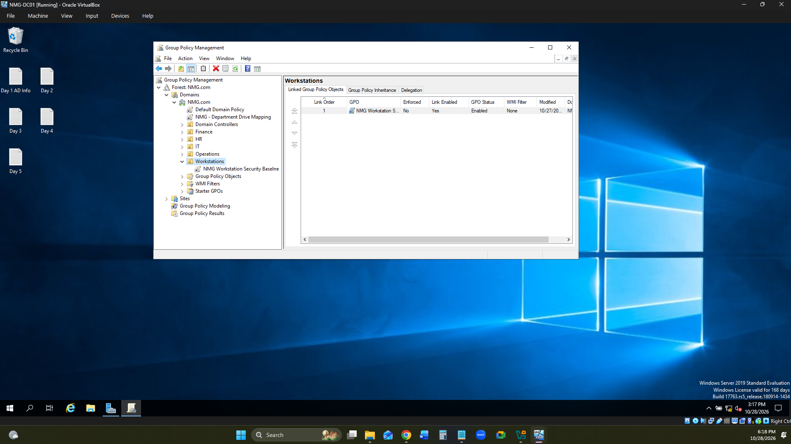

**Inactivity Policy Configuration**

Configured the inactivity timeout to 900 seconds.

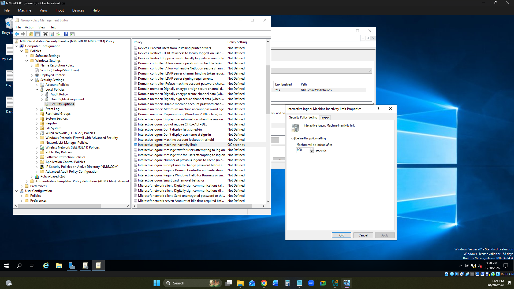

**Group Policy Verification**

Verified the workstation received the configured Group Policy settings.

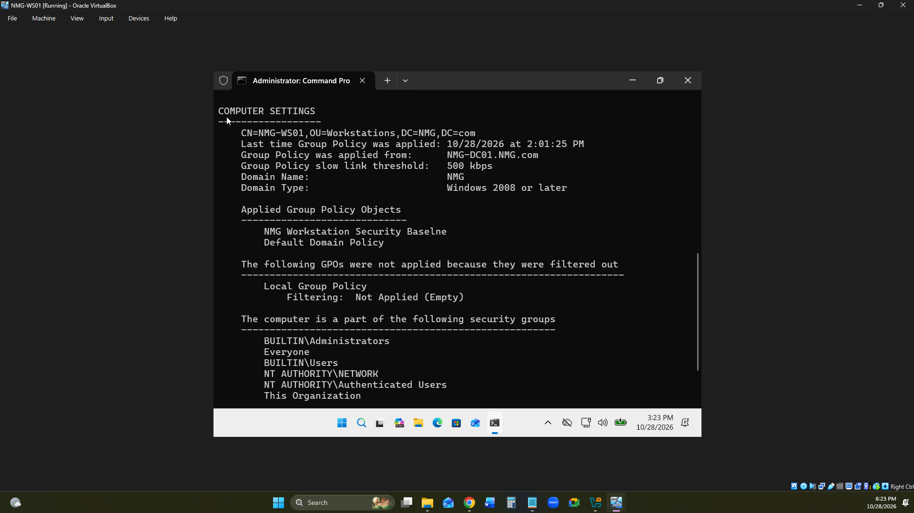

### Day 6 — Departmental SMB Network Shares

Configured departmental SMB shares for Finance, HR, IT, and Operations.

Implemented access controls using existing Active Directory security groups.

**Network Shares**

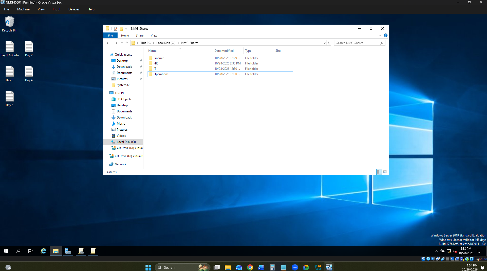

**HR Shared Drive**

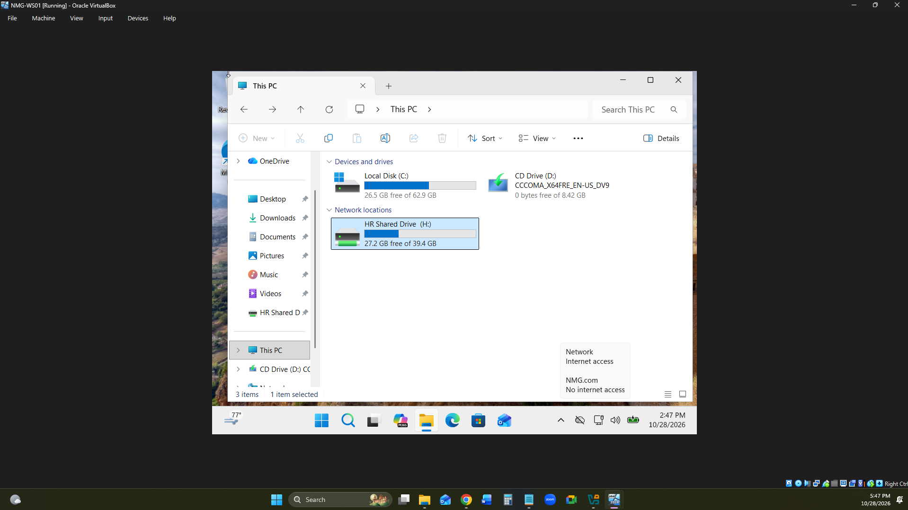

### Day 6 — NTFS and Share Permissions

Configured NTFS and share-level permissions to restrict departmental access based on security group membership.

**NTFS Permissions**

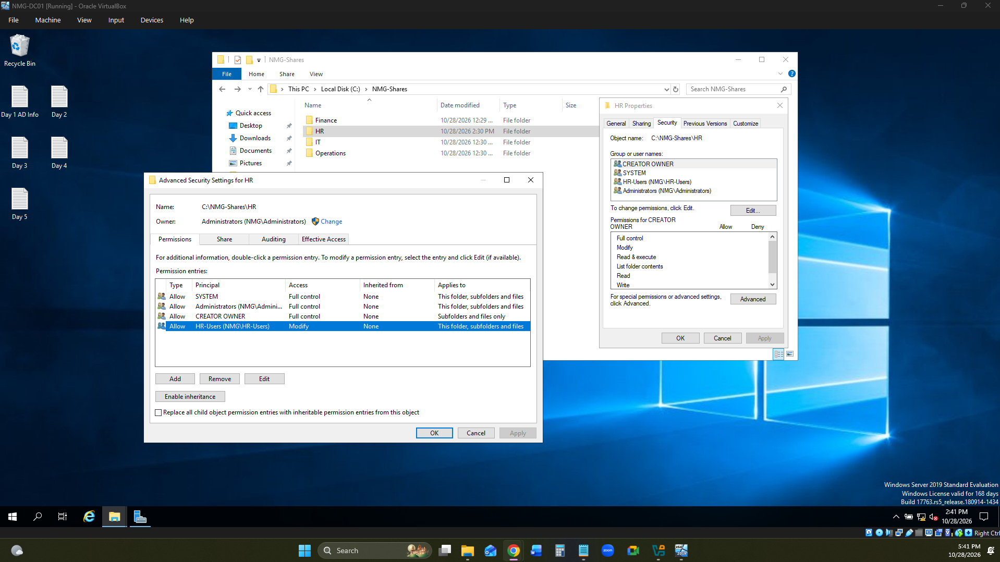

**SMB Share Permissions**

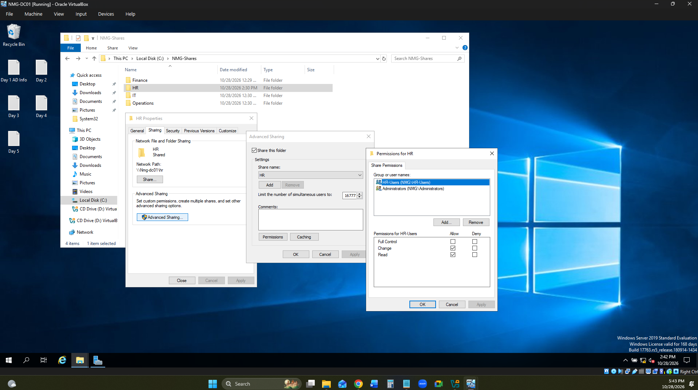

**Network and NTFS Access Control**

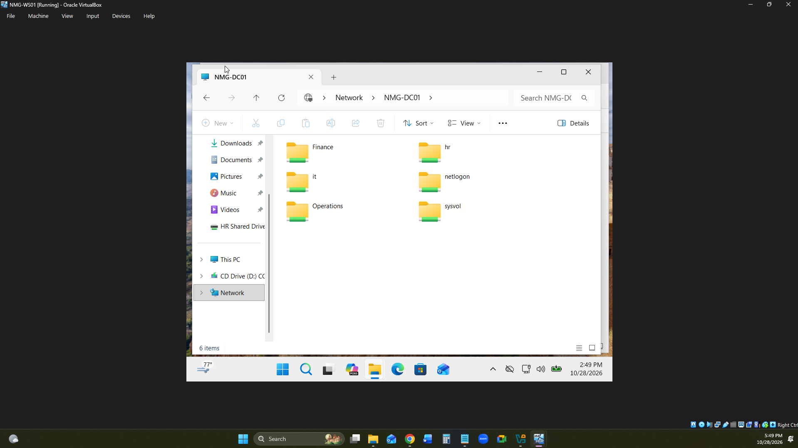

### Day 6 — Automated Drive Mapping

Used Group Policy Preferences to automatically map departmental network drives based on Active Directory security group membership.

**Group Policy Drive Maps**

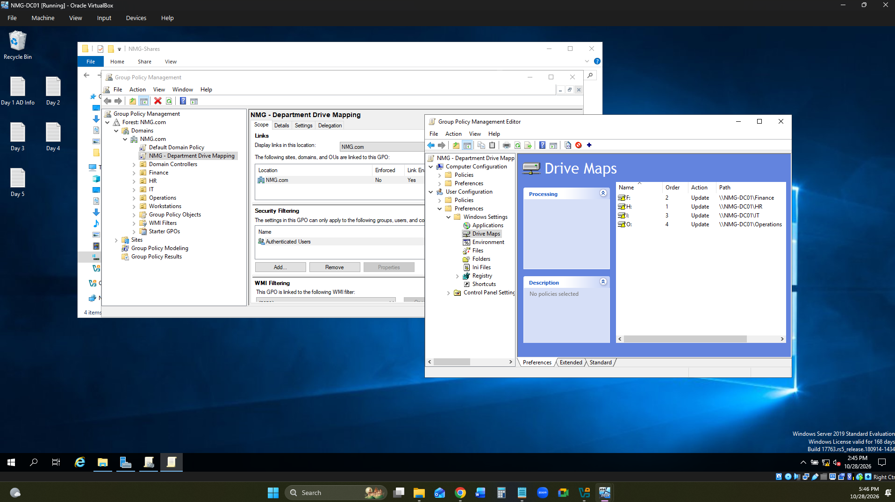

### Day 6 — Access Testing and Verification

Tested employee access to departmental network resources.

Confirmed that authorized users could access their assigned shares while unauthorized access to other departments was restricted.

**Unauthorized Access Test**

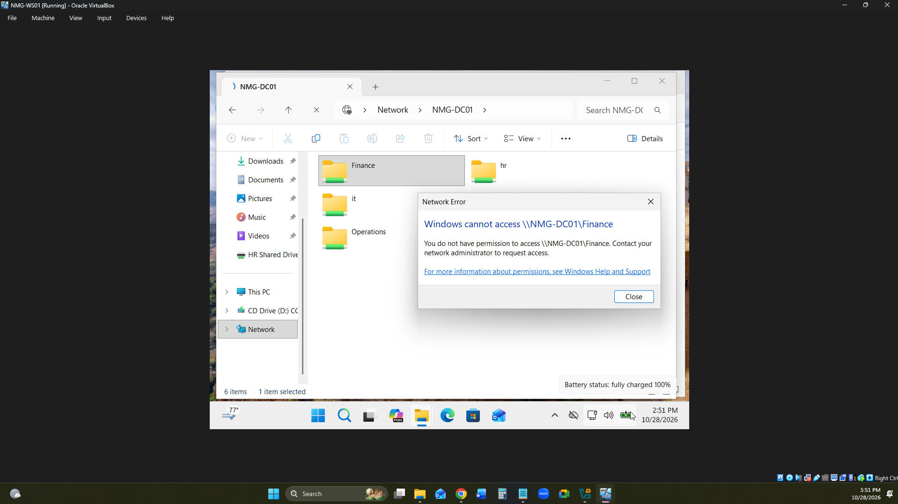

**File Access Verification**

Verified file creation, modification, and deletion permissions through an authorized network share.

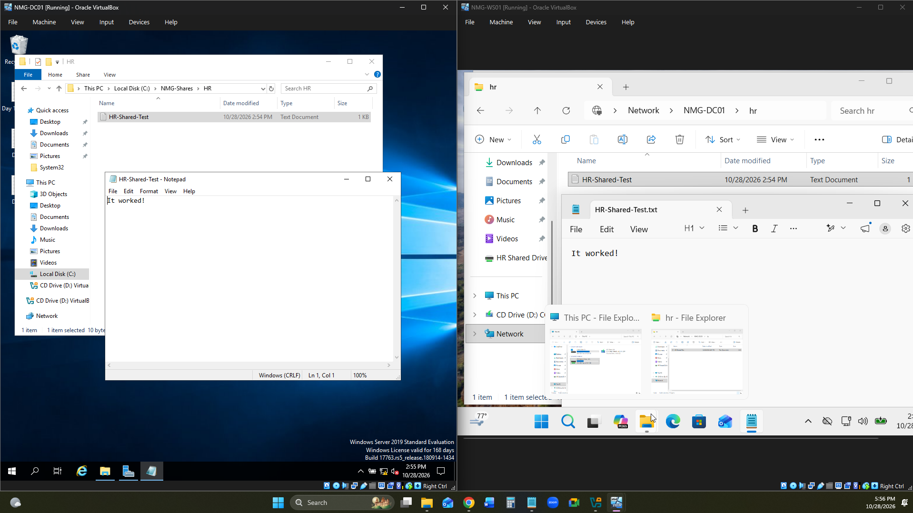

## Key Accomplishments

* Deployed and joined a Windows 11 workstation to the NMG.com domain.
* Implemented a workstation security GPO with a 15-minute inactivity limit.
* Configured 4 departmental SMB shares with NTFS and share-level permissions.
* Automated 4 departmental network drive mappings using security group targeting.
* Verified authorized access and restricted unauthorized departmental access.
* Successfully tested file creation, modification, and deletion through a mapped network drive.
* Validated network connectivity and DNS resolution.
* Documented infrastructure configuration and troubleshooting evidence.

## Skills Demonstrated

* Windows Server Administration
* Windows 11 Domain Integration
* Active Directory Domain Services (AD DS)
* Group Policy Management
* DNS and Network Troubleshooting
* SMB Network File Sharing
* NTFS Permissions
* Role-Based Access Control (RBAC)
* Group Policy Preferences
* Network Drive Mapping
* Access Control Troubleshooting
* Technical Documentation

## Technical Documentation

* [Network Configuration](Documentation/Network%20Config%20File.md)
* [Group Policy Configuration](Documentation/Group%20Policy%20Config.md)
* [SMB & NTFS Permissions](Documentation/SMB%20%26%20NTFS%20Permissions.md)
* [Drive Mapping & Access Testing](Documentation/Drive%20Mapping%20%26%20Testing.md)

